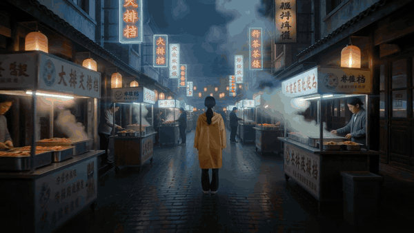

# None of this was filmed

**Live: [video.navonsimon.com](https://video.navonsimon.com/)**

A showcase of what AI video generation can do in 2026, with a real generated clip for each of twelve
capabilities. Claude directed every shot and wrote the prompts, the clips were generated with the
[Higgsfield](https://higgsfield.ai) CLI, the reels were cut in code with
[HyperFrames](https://hyperframes.heygen.com), and the site runs on a home Kubernetes cluster
behind a Cloudflare Tunnel.

[](https://video.navonsimon.com/)

*Seven seconds of the 40-second showreel. Every frame was generated; the cut and titles are HTML rendered to video.*

## The twelve capabilities

| # | Group | Capability | What it does | Models |
|---|---|---|---|---|
| 01 | Generate | **Text → video** | A written prompt becomes a cinematic shot, with camera moves, lighting and style all directed in words. | Seedance 2.5, Kling 4.0, Veo 3.1, Wan 3.0 |
| 02 | Generate | **Image → video** | A still photo is brought to life: products spin, portraits breathe, landscapes move. | Kling 3.0 Turbo, Seedance 2.0, Minimax Hailuo |
| 03 | Generate | **Start & end frames** | Two images as the first and last frame; the model invents the motion in between. | Kling 3.0 Omni (Frames) |
| 04 | Generate | **Native audio & dialogue** | The clip comes with its own sound: speech, ambience and effects generated together with the picture. | Veo 3.1, Veo 3.1 Lite |
| 05 | Direct | **Character consistency** | The same character across different shots and scenes, or a trained digital twin of a real person. | Kling 3.0 Omni, Higgsfield Soul |
| 06 | Direct | **Motion control** | Copy a movement from a reference clip onto a different character: a dance, a gesture, a walk. | Kling 3.0 Motion Control, Genjutsu |
| 07 | Edit | **Video editing** | Change what is already filmed: swap objects, restyle a scene, or sketch the motion you want. | Kling 3.0 Omni Edit, FLUX 3 Video Edit, Draw To Video |
| 08 | Edit | **Post-production** | The finishing tools: sharper, smoother, cleaner, and re-cut for every screen. | Topaz, Reframe, Video Background Remover, Dubbing |
| 09 | Produce | **Ads & UGC** | Product ads, presenter videos and UGC-style clips from a product photo or a store link. | Marketing Studio |
| 10 | Produce | **Narrated explainers** | A topic or a document becomes a narrated, illustrated story video, one consistent style throughout. | Gemini Omni, Seed Audio |
| 11 | Produce | **Code-rendered video** | Motion graphics written as HTML and rendered frame by frame: titles, charts, captions, this site's reel. | HyperFrames |
| 12 | Produce | **Music, sound & covers** | The pieces around the video: an original soundtrack, sound effects and a thumbnail that gets the click. | Seed Audio, Nano Banana Pro |

**Spend:** 22 Higgsfield jobs, 78.1 credits in total (Starter plan, about $5.50 of a $19 month).

Every clip's model, prompt and credit cost is logged in [`gen/manifest.json`](gen/manifest.json).

## How it was made

1. **Directed in words.** Each shot is one entry in [`gen/batch.json`](gen/batch.json): model, prompt,
   parameters and an estimated cost from `higgsfield generate cost`.
2. **Generated on Higgsfield.** [`gen/run.py`](gen/run.py) runs the batch in dependency waves (stills
   first, because they feed image-to-video, start/end-frame and reference jobs), in parallel within a
   wave, with a hard budget cap. Finished jobs are downloaded and recorded in the manifest; a rerun
   only does what is missing.
3. **Edited in code.** [`reel/`](reel) holds the HyperFrames projects: the 16:9 showreel, the 9:16
   social cut and the code-rendered chart in category 11. Each is an HTML page with a GSAP timeline,
   rendered frame by frame to MP4.
4. **Self-hosted.** [`deploy/`](deploy) puts the page in a ConfigMap and the clips on a volume, served by
   nginx in its own namespace. The public path is Cloudflare Tunnel → edge nginx → NodePort.

## Repo layout

```
site/          index.html (the page) + data.js (the capability list and each demo)
media/         transcoded clips and posters served at /media/
gen/           batch.json, run.py, manifest.json
reel/          HyperFrames projects (showreel, vertical cut, code demo)
deploy/        k8s manifest, nginx config, deploy script
```

## Commands

```sh
python3 gen/run.py --dry          # plan and projected spend
python3 gen/run.py                # generate everything still missing
python3 gen/run.py hero           # (re)generate one job; delete its manifest entry first
python3 gen/run.py --refetch edit # re-download a finished job by its job id
python3 gen/publish.py            # transcode gen/out/ into web-sized media/ (720p MP4 + JPG posters)
cd reel/showreel && npx hyperframes render --output renders/showreel.mp4
./deploy/deploy.sh                # page + config
./deploy/deploy.sh media          # also sync media/ to the volume
```

## Stack

Higgsfield CLI (Seedance 2.5, Kling 4.0, Kling 3.0 Omni, Veo 3.1 Lite, Genjutsu, Nano Banana, GPT Image 2.5,
Seed Audio) · HyperFrames + GSAP · ffmpeg · plain HTML/CSS/JS · nginx · Kubernetes (kubeadm) ·
Cloudflare Tunnel.

## Author

Simon Navon · [projects.navonsimon.com](https://projects.navonsimon.com/)
